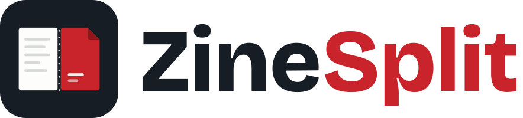
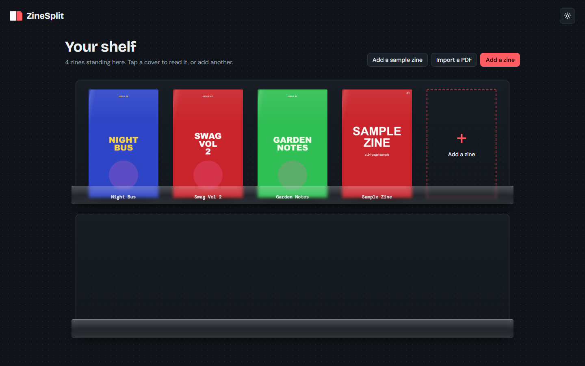
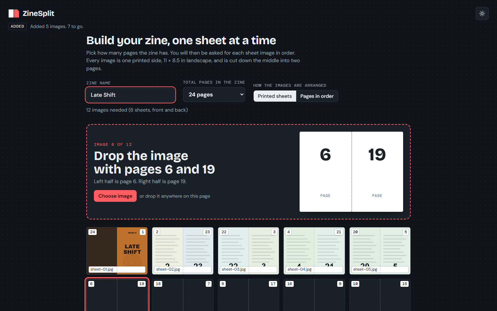
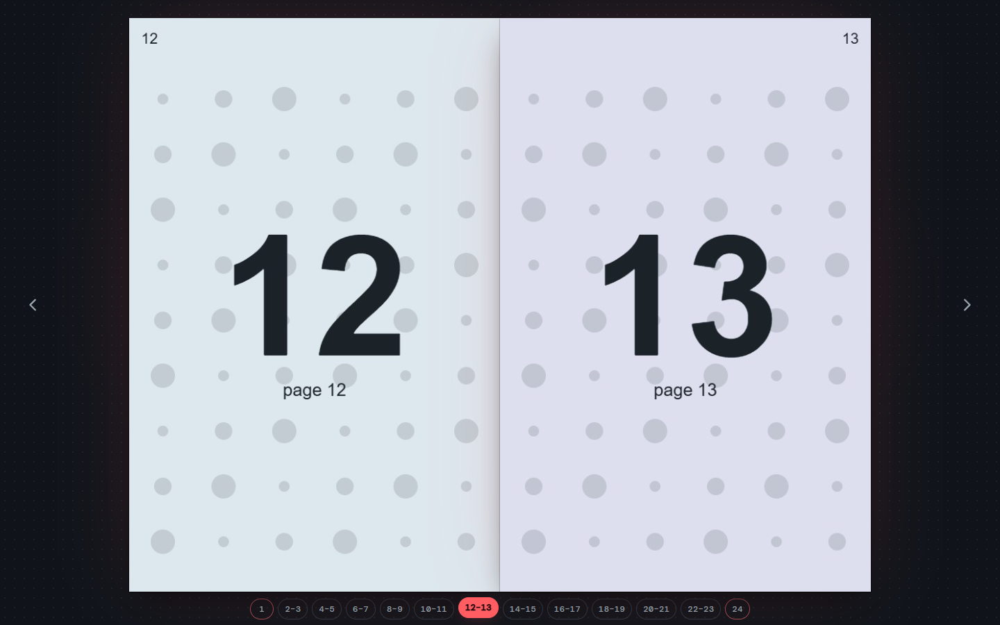

<p align="center">
  <picture>
    <source media="(prefers-color-scheme: dark)" srcset="assets/logo-dark.svg">
    
  </picture>
</p>

<p align="center"><b>Read your printed zine as a book.</b></p>

<p align="center">
  <a href="../../releases/latest"></a>
  
  
  
  
  
  <a href="LICENSE"></a>
</p>

<p align="center">
  <a href="#get-the-app">Download</a> ·
  <a href="#quick-start">Quick start</a> ·
  <a href="#controls">Controls</a> ·
  <a href="#faq">FAQ</a> ·
  <a href="#build-from-source">Build</a>
</p>

---

Export each printed sheet of your zine as an image, drop the images in, and ZineSplit cuts every image down the middle, puts the pages back in reading order, and stands your zine on a shelf with its cover facing out. Open one to read it as two-page spreads, or export it as a **PDF in page order** or as **separate page images** for printing.

<p align="center"></p>

Everything runs on your device. Your images are never uploaded anywhere. ZineSplit runs in a browser, as a Windows app, as a Linux app, and as an Android app.

## Who it's for

ZineSplit is for people who lay out a zine **one landscape sheet per image, folded in half**, and want to read it back as a book before printing.

If you design this way (for example in Affinity, Illustrator, Photoshop, Canva or Figma), each sheet holds two pages side by side, and the pages are in *printing order*, not reading order. A 24-page zine is 12 sheets, where sheet 1 has the front cover on the right and the back cover on the left, sheet 2 has page 2 beside page 23, and so on. That is hard to proof by eye.

**Use case:** export each sheet as a PNG or JPEG, drop them into ZineSplit, and flip through the finished zine as two-page spreads. Check page order, facing-page layouts, and where the spreads fall before you waste paper.

It is not a general PDF reader, and it is not for zines already laid out as single pages in reading order (though a **Pages in order** layout is included for that case).

## Features

- **The shelf.** A magazine rack that holds all your zines, each standing upright with its front cover showing. Zines are saved on your device, so they are there next time you open the app.
- **Cut and reorder.** Each sheet image is cut down the middle and the pages go back into reading order, with the front cover first and the back cover last.
- **Read as a book.** Two-page spreads with a page turn, arrow keys, numbered page buttons under the book, and a full screen mode that shows only the pages.
- **Export a PDF.** One PDF with every page in reading order, cut from your sheets.
- **Export page images.** A ZIP of lossless PNGs (`page-01.png`, `page-02.png` ...) in reading order, for printing or for other tools.
- **Dark and light themes.**

On the shelf, hover over a zine (or tap it on a phone) to get **PDF** and **Images** buttons. Inside the reader, use **Export PDF** and **Page images** in the top bar.

## Get the app

Download from the **[latest release](../../releases/latest)**.

| Platform | File | How to run it |
|---|---|---|
| **Windows 10 / 11** | `ZineSplit-x.y.z-windows-setup.exe` | Double-click to install. Or use `…-windows-portable.exe`, which runs without installing. If SmartScreen appears, choose **More info → Run anyway** (the app is not code-signed). |
| **Linux** | `ZineSplit-x.y.z-linux-x86_64.AppImage` | `chmod +x` it and run. On Debian / Ubuntu you can instead `sudo apt install ./ZineSplit-*.deb`. |
| **Android 7+** | `ZineSplit-x.y.z-android.apk` | Open it on your phone and allow installs from your browser or file manager the first time. New versions install over the old one and keep your shelf. |
| **iPhone / iPad** | Web app | Open ZineSplit's web link in **Safari**, tap **Share → Add to Home Screen**. It opens full screen with its own icon and keeps your shelf on the phone. (iOS can't run a downloaded HTML file, so it needs the link.) |
| **Any browser** | `ZineSplit-x.y.z.html` | One file with everything inside. Double-click it to open. Nothing to install, works offline. |

<p align="center">
  
  
</p>

## Quick start

1. **Open it and add a zine.** Open the app (or double-click `index.html`), then choose **Add a zine** on the empty shelf.
2. **Name it and pick the page count.** Choose how many pages the zine has (4, 8, 12 ... 48). A 24-page zine needs 12 images.
3. **Drop each sheet when prompted.** ZineSplit asks for one image at a time, for example *"Image 3 of 12: drop the image with pages 3 and 22"*. Drop files anywhere on the page, or use **Choose image**. Dropping several files at once fills the next sheets in file-name order.
4. **Read or shelve it.** Click **Read your zine** to open it, or **Save to shelf** to put it away. The front cover shows alone, then you see spreads (2 | 3, 4 | 5 ...), and the back cover shows alone at the end.
5. **Export.** From the shelf or the reader, download the PDF or the page images.

Not ready with your own sheets yet? Click **Add a sample zine** on the shelf.

## Controls

| Action | How |
|---|---|
| Next / previous page | Right / left arrow key, the on-screen arrows, or click the right / left page |
| Touch screens | Swipe left or right |
| Jump to the covers | Home / End |
| Jump to a page or spread | Click its number under the book |
| Back to the shelf | The Shelf button, or click the ZineSplit logo |
| Single page or two-page spread | The view button at the top |
| Full screen | The Full screen button, or press F |
| Change images or the page count | Edit pages |

## What your images should look like

Each image is **one printed side of a sheet**, landscape, **11 x 8.5 in**. It folds in half into two 5.5 x 8.5 in pages, and ZineSplit cuts it exactly down the middle.

For a 24-page zine, the 12 images in order are:

| Image | Left half | Right half | | Image | Left half | Right half |
|---|---|---|---|---|---|---|
| 1 | 24 (back cover) | 1 (front cover) | | 7 | 18 | 7 |
| 2 | 2 | 23 | | 8 | 8 | 17 |
| 3 | 22 | 3 | | 9 | 16 | 9 |
| 4 | 4 | 21 | | 10 | 10 | 15 |
| 5 | 20 | 5 | | 11 | 14 | 11 |
| 6 | 6 | 19 | | 12 | 12 | 13 |

Images are read in file-name order, with numbers sorted naturally (`Sheet 2` comes before `Sheet 10`). The setup screen shows which pages belong to each image, so you can check before you open the zine.

If your images already hold two consecutive pages each (1 | 2, 3 | 4 ...), choose **Pages in order** instead of **Printed sheets**.

### Exporting from your design app

Any app works as long as it can export one image per sheet side. Look for an option like "export artboards" or "export all pages", and choose PNG, JPEG or WebP.

- **Name the files so they sort in order**, for example `sheet-01.png`, `sheet-02.png`.
- **Use 150 dpi** (1650 x 1275 px per sheet). It looks sharp on screen and loads quickly. Use 300 dpi only if people will zoom in a lot.
- **Hide guide layers first.** Fold lines, crop marks or guides sitting on the center of the sheet will show as a faint edge on the cut.
- **File size:** WebP is usually the smallest, then JPEG, then PNG. PNG is the best choice for flat color and crisp text.

## FAQ

**The pages look out of order.**
Check the file names. Files are sorted by name, so `sheet-1`, `sheet-2` ... `sheet-12` works, and so does `sheet-01` ... `sheet-12`. Use **Edit pages** and click a sheet to replace any image that landed in the wrong slot.

**There is a thin line down the middle of my pages.**
A fold line or guide was included in the export. Hide that layer and export again.

**It says my images are portrait.**
ZineSplit expects landscape images that split into two pages. A portrait image is one single page. Export each printed sheet side as a landscape image.

**Can I open it before every sheet is added?**
Yes. Click **Read what I have**. Missing sheets appear as blank pages, and they export as blank pages too.

**Where are my zines stored?**
In the app's own storage on this device (the browser's, or the app's). Clearing site data in the browser, or uninstalling the app, removes them, so keep your original sheet images.

**How is the PDF made?**
Each page is cut from its sheet at full size and written into the PDF as a JPEG, in reading order. Page size follows your sheet: 5.5 x 8.5 in for an 11 x 8.5 in sheet. The page images are lossless PNGs.

**Does it work offline?**
Yes. The apps include their fonts. In a browser, `index.html` finds the `fonts` folder next to it.

**Is my artwork uploaded anywhere?**
No. Images are read and stored locally on your device.

**It is slow on my phone.**
Large images take memory because the browser unpacks each one into raw pixels. Export at 150 dpi, or fewer pixels, for phones and older computers.

## How it works

ZineSplit does not edit your images. Each page is a box showing one half of a sheet image. A page's position in the book decides which half of which image it shows, using the standard folded-booklet order (for an N-page zine: front of sheet k is N-2k | 2k+1, back of sheet k is 2k+2 | N-2k-1). The page turn is a CSS 3D rotation. The PDF and ZIP writers are built in, so there are no runtime dependencies. The app is `index.html` plus a `fonts` folder. Windows and Linux builds wrap it in Electron, and the Android build wraps it with Capacitor.

## Build from source

```sh
npm install
npm run desktop        # run the desktop app
npm run dist           # build the installer for the OS you are on (into dist/)
npx cap add android    # once, then:
npm run android:sync
cd android && ./gradlew assembleDebug    # test APK in android/app/build/outputs/apk/debug/
```

Windows builds need Windows and Linux builds need Linux. Android needs the Android SDK and Java 21.

### Releasing

The [release workflow](.github/workflows/release.yml) builds everything on GitHub. Bump `version` in `package.json`, add a section to [CHANGELOG.md](CHANGELOG.md), then push a tag:

```sh
git tag v2.1.0
git push origin v2.1.0
```

Windows, Linux, Android and browser files are attached to a new release, with the changelog section as its notes. The APK is signed with the release key stored in the `ANDROID_KEYSTORE_B64` and `ANDROID_KEYSTORE_PASSWORD` repository secrets. Always sign with the same key, or phones will refuse the update.

## Browser support

Current versions of Chrome, Edge, Firefox and Safari, on desktop and phones.

## Contributing

Issues and pull requests are welcome. Edit `index.html`, open it in a browser, and test with **Add a sample zine**. Run `npm run web:build` to refresh the `www` folder used by the desktop and Android builds.

Ideas that would be useful:

- Open a single PDF and treat each page as a sheet
- Right-to-left reading order

## License

[MIT](LICENSE) © 2026 Hamza
